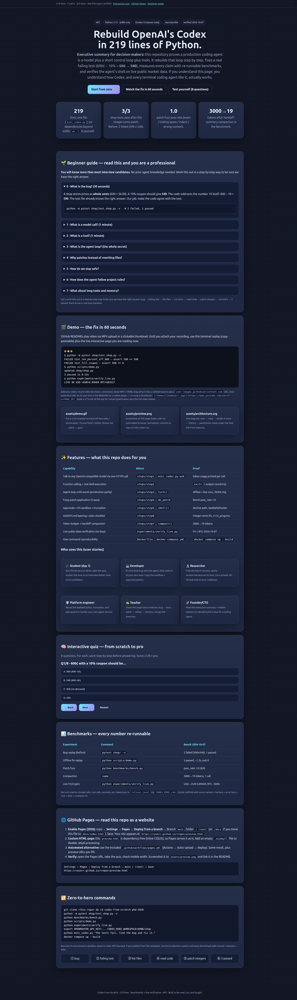

# Codex From Scratch — Rebuild OpenAI's Coding Agent in 219 Lines

> **One-sentence thesis:** an agent is a model, a loop, and tools — everything else makes it safer and smarter.

[](LICENSE)
[](mini_codex.py)
[](mini_codex.py)
[](docker-compose.yml)
[](shop/test_shop.py)
[](experiments/verify_live.py)

**Executive summary (read this and decide in 30 seconds).** This is a complete, runnable rebuild of a production terminal coding agent in one 219-line Python file with zero third-party dependencies. It fixes a real failing test — 600¢ with a 10% coupon returns 590 instead of 540 — by listing files, running tests, reading code, applying a one-spot integer-cents patch, and re-running tests. Every claim ships with a re-runnable proof: offline benchmarks (patch fuzz 4/4, compaction 3000→19 tokens), live public-data verification (ECB foreign exchange + Bitcoin price, 2026-10-07), Docker Compose reproducibility, and an interactive web companion with a scratch-to-pro quiz. If you are evaluating coding agents for your team, teaching them, or hardening your own, start here: you will see the entire control loop, safety model, and memory strategy with nothing hidden.

**Production reference:** [`openai/codex`](https://github.com/openai/codex) — 128,177 stars, Rust, `codex-rs/core/src/state/turn.rs`, `seek_sequence`, Seatbelt/Landlock sandboxing, `AGENTS.md`, `/responses/compact`.

🌐 **Read this repo as a website:** open [`preview.html`](preview.html) locally, or click the live links below (all three serve the same interactive page — if one 404s, your Pages source is set to the other folder; see [GitHub Pages](#-github-pages)):

| Entry | Live link | When it works |
|-------|-----------|---------------|
| `/` | [m0-ar.github.io/codex-from-scratch-phd-2026/](https://m0-ar.github.io/codex-from-scratch-phd-2026/) | source `/` (root `index.html` → redirects to `preview.html`) **or** source `/docs` (`docs/index.html`) |
| `/preview.html` | [m0-ar.github.io/codex-from-scratch-phd-2026/preview.html](https://m0-ar.github.io/codex-from-scratch-phd-2026/preview.html) | source `/` (root `preview.html`) |
| `/docs/preview.html` | [m0-ar.github.io/codex-from-scratch-phd-2026/docs/preview.html](https://m0-ar.github.io/codex-from-scratch-phd-2026/docs/preview.html) | source `/` (root serving `docs/` path) |

Recommended setting: **Settings → Pages → Deploy from a branch → `main` → `/docs`**, then all three resolve (`/` via `docs/index.html`, `/preview.html` via mirror, `/docs/preview.html` direct). A ready-made Actions workflow lives at [`.github/workflows/pages.yml`](.github/workflows/pages.yml).

---

## Table of contents

- [🎬 Demo (video + screenshots)](#-demo-video--screenshots)
- [🌱 Beginner guide — read this and you are a professional](#-beginner-guide--read-this-and-you-are-a-professional)
- [⚡ Zero-to-hero in 60 s](#-zero-to-hero-in-60-s)
- [🧩 The seven parts](#-the-seven-parts)
- [✨ Features](#-features)
- [👥 Who is this for (user stories)](#-who-is-this-for-user-stories)
- [🗂️ Repo map](#️-repo-map)
- [📊 Benchmarks (re-run me)](#-benchmarks-re-run-me)
- [🌍 Live-data verification](#-live-data-verification)
- [🕵️ Hidden patterns](#️-hidden-patterns)
- [🛡️ Safety](#️-safety)
- [📏 Benchmark literacy](#-benchmark-literacy)
- [🐳 Docker reproducibility](#-docker-reproducibility)
- [🧪 Interactive quiz](#-interactive-quiz)
- [🌐 GitHub Pages](#-github-pages)
- [🏋️ Exercises](#️-exercises)
- [📖 Full paper](#-full-paper)
- [🤝 Contributing](#-contributing)
- [📜 Citation & license](#-citation--license)

---

## 🎬 Demo (video + screenshots)

> A picture answers "what does this actually do" before any paragraph can. Watch 60 seconds, then run 60 seconds.



**Interactive site:** [`preview.html`](preview.html) (mirror: [`docs/index.html`](docs/index.html)) — open locally or via GitHub Pages (see [GitHub Pages](#-github-pages)). Includes the 8-question quiz from scratch to pro.

**Video (add yours in 2 minutes).** GitHub renders video in READMEs two ways: (1) drag an MP4 (<10MB) into an Issue comment to get a `user-images.githubusercontent.com` URL, paste that URL on its own line for a native player; (2) wrap a thumbnail in a link for longer narrated videos:

```markdown
[](https://www.youtube.com/watch?v=YOUR_VIDEO_ID)
```

Suggested script: failing `pytest` (590 ≠ 540) → agent lists files → runs tests → reads `shop.py` → applies integer-cents patch → 3 passed → live FX check. Keep a ≤15-second looping GIF at the top (`assets/demo.gif`, tools: `vhs`, `terminalizer`, `ScreenToGif`, `Gifski`) plus the full narrated video below.

**Screenshots (committed, so links never rot).**

| File | What it shows | Status |
|------|---------------|--------|
| [`preview.html`](preview.html) / [`docs/index.html`](docs/index.html) | Interactive companion site: hero metrics, beginner guide, terminal replay, features, 8-question quiz | ✅ included |
| `assets/preview.png` | Screenshot of this page at desktop + mobile width | ⬜ capture after Pages deploy (see [GitHub Pages](#-github-pages)) |
| `assets/demo.gif` | ≤15s terminal loop: fail → patch → pass | ⬜ record with `vhs` and commit |
| `assets/architecture.svg` | One diagram: user → loop → model ⇄ tools → history → patch/tests | ⬜ optional, keep under the fold |

Terminal replay (copy-pasteable until your video lands):

```text
$ python -m pytest shop/test_shop.py -v
FAILED test_ten_percent_off_600 — assert 590 == 540
FAILED test_full_coupon — assert 500 == 0
$ python scripts/demo.py
updated shop/shop.py
3 passed in 0.15s
$ python experiments/verify_live.py
LIVE OK USD->EUR=0.89469 BTC=$83317
```

---

## 🌱 Beginner guide — read this and you are a professional

You will know more than most interview candidates. No prior agent knowledge needed. Let's work this out in a step-by-step way to be sure we have the right answer.

**0 · The bug (30 seconds).** Prices are whole cents (600 = $6.00). A 10% coupon should give **540**. The code subtracts the number 10 itself: 600 − 10 = **590**. The test already knows the right answer; our job is to make the code agree with it.

```bash
python -m pytest shop/test_shop.py -v   # 2 failed, 1 passed
```

**1 · A model call (1 minute).** Your program sends one web request with messages: `system` (who the model is) + `user` (the task). The server returns text, or a **tool call** (a request to run something). The model never touches your computer — it only asks. See `steps/step1_talk_to_model.py`.

**2 · A tool (1 minute).** A tool is a small JSON description: name + what it does + parameters. Our first tool is `shell` with one string `command`. Python runs it with `bash`, returns `exit=` plus output as a `tool` message. See `steps/step2_one_tool.py`.

**3 · The agent loop (the whole secret).** Call the model, run the tools it asks for, repeat until it answers in words. That is 28 lines (`steps/step3_agent_loop.py`). History goes back every round, so errors become evidence for the next try. The production system implements the same loop in Rust (`turn.rs` / `run_turn`).

**4 · Patches, not rewrites.** Rewriting a whole file risks dropping lines. `apply_patch` says: keep context (` `), remove (`-`), add (`+`). The matcher tries exact, then trailing-space-tolerant, then indent-tolerant. Try `python benchmarks/bench.py`.

**5 · Safety.** Two layers: **approvals** (dangerous commands ask first) and **sandbox** (the OS blocks network + writes outside the workspace). Long output is cut to 4000 characters. See `steps/step5_safety.py`.

**6 · Project rules.** A short system prompt plus `shop/AGENTS.md` (integer cents, run tests after edits). The production agent walks git-root → your folder joining every `AGENTS.md` (32KB cap). Without it the fix uses floats; with it the fix uses `(s*pct+50)//100` and explains why. See `steps/step6_instructions.py`.

**7 · Memory for long tasks.** Every call resends history, so cost grows. Past a budget, the agent asks for a **handoff summary**, drops old messages, keeps system + instructions + summary. Too small a budget re-reads files forever (14s → 105s). Production compacts near 90–95% of a 272k window. See `steps/step7_memory.py`.

Step-by-step chain to memorize: bug → failing test → list files → run tests → read code → patch integers → run tests → 3 passed. Each arrow is one loop turn.

---

## ⚡ Zero-to-hero in 60 s

```bash
git clone <this-repo> && cd codex-from-scratch-phd-2026
python -m pytest shop/test_shop.py -v        # 2 failed, 1 passed — reproduces the bug (590 != 540)
python benchmarks/bench.py                   # patch fuzz 4/4, compaction 3000->19 tokens, no key needed
python scripts/demo.py                       # offline fix replay: 3 passed in ~1.2 s
python experiments/verify_live.py            # live ECB + CoinGecko: USD->EUR 0.89469, BTC ~$83k
# Live-model agent (needs key, never commit it):
export OPENROUTER_API_KEY=... CODEX_MINI_WORKSPACE=$PWD/shop
python mini_codex.py "The tests fail, find the bug and fix it."
docker compose up --build                    # full reproducibility (agent + live verifier)
```

Requirements: Python 3.12, `pip install -r requirements.txt` (pytest only). Keys live in environment variables, never in code.

---

## 🧩 The seven parts

| # | File | Idea (production mirror) |
|---|------|--------------------------|
| 1 | `steps/step1_talk_to_model.py` | One HTTPS POST `{model, messages}` → first-choice message; key via env; tokens ≈ chars/4. |
| 2 | `steps/step2_one_tool.py` | `tool()` → function-calling schema; `shell()` returns `exit=` + output as `role=tool`. |
| 3 | `steps/step3_agent_loop.py` (28 lines) | `while True: ask → run tools → repeat` until words; cf. `run_turn` / `needs_follow_up`. |
| 4 | `steps/step4_apply_patch.py` | `*** Begin/End Patch`, `@@` hint, ` /-/+`; 3-pass matcher (exact/rstrip/strip) cf. `seek_sequence`. |
| 5 | `steps/step5_safety.py` | Approval regex (`rm -rf`, `sudo`, `reset --hard`) + Seatbelt deny-net/deny-write + 4000-char truncate. |
| 6 | `steps/step6_instructions.py` | System prompt + git-root→cwd `AGENTS.md` (32KB) + `update_plan` (≤1 in_progress). |
| 7 | `steps/step7_memory.py` | Token budget + handoff-summary compaction; prod: `/responses/compact` at ~90–95% of 272k. |
| ★ | `mini_codex.py` (**219 lines**, `wc -l`, stdlib only) | All seven composed + JSONL rollout log + per-turn metrics. |

Test shop: `shop/shop.py` (planted `discount = coupon_percent` bug), `shop/test_shop.py` (600¢/10%→540, 0%→600, 100%→0), `shop/AGENTS.md` (integer-cents rule `(s*pct+50)//100`, never floats; read before editing; test after editing).

---

## ✨ Features

- **One-call model I/O** — OpenAI-compatible chat completions, header auth, usage printed per call.
- **Real function calling** — machine-readable schemas; model chooses words vs. tool calls.
- **Production-parity loop** — model → tools → model with full-history grounding and JSONL trace.
- **Fuzzy patch engine** — context-aware updates, add/delete file, loud failures the model can retry.
- **Defense in depth** — approval gate, OS sandbox (Seatbelt policy + Docker isolation on Linux), output truncation, `suggest`/`auto_edit`/`full_auto` modes.
- **Instruction layering** — `AGENTS.md` discovery with size cap plus single-`in_progress` plan guard.
- **Budgeted memory** — pre-call token check, summarization compaction, thrash demonstration.
- **Benchmark harness** — deterministic offline metrics (pass rate, ms, tokens, calls).
- **Live verification** — keyless foreign-exchange + crypto checks with multi-endpoint fallback.
- **One-command repro** — Dockerfile + Compose + Makefile; pinned model env; offline-first.

---

## 👥 Who is this for (user stories)

- **🎓 Student (day 1).** Run the demo, ace the [quiz](#-interactive-quiz), and explain the agent loop in interviews with a whiteboard diagram from memory.
- **💻 Developer.** Point the agent at the sample shop, watch it fix 590→540, then reuse the loop + sandbox pattern on your own repository.
- **🔬 Researcher.** Fork `benchmarks/`, report variant + harness + error bars + cost + date, and run a private 20–50-task evaluation on your codebase.
- **🛡️ Platform engineer.** Copy the approval regex, Seatbelt policy, truncation, and plan guard into your agent service.
- **✍️ Teacher.** Teach top-to-bottom: bug → loop → patch → safety → memory. Assign: add `read_file`, stream responses, add a Linux sandbox.
- **🚀 Founder/CTO.** Read the executive summary + hidden patterns to make a build-vs-buy decision in one sitting.

---

## 🗂️ Repo map

```text
mini_codex.py  steps/step{1..7}_*.py  shop/{shop,test_shop,AGENTS}.py/md
benchmarks/bench.py  experiments/verify_live.py  scripts/demo.py
preview.html  docs/index.html  .nojekyll  .github/workflows/pages.yml
docs/HIDDEN_PATTERNS.md  paper/PAPER.md  Dockerfile  docker-compose.yml  Makefile
```

---

## 📊 Benchmarks (re-run me)

| Experiment | Command | Result 2026-10-07 |
|------------|---------|-------------------|
| Bug replay (before) | `pytest shop/ -v` | 2 failed (`590 != 540`, `500 != 0`), 1 passed |
| Offline fix replay | `python scripts/demo.py` | 3 passed, ~1.2 s, exit 0 |
| Patch fuzz (exact/trailing/indent/wrong) | `python benchmarks/bench.py` | **pass_rate 1.0** (4/4, ~0.1 ms each) |
| Compaction (limit 1000) | same | **3000 → 19 tokens**, 1 call |
| Compaction thrash (limit 700) | see paper §4 | 12 compactions, 14 s → 105 s |
| Real-vs-mini diff | reference run | line-for-line identical |

Per-turn metrics (model calls, tool calls, seconds, estimated tokens) are emitted to `rollout.jsonl` via `CODEX_MINI_LOG` — always quote your scaffold alongside your score.

---

## 🌍 Live-data verification

No keys. The agent's `shell` tool fetches public endpoints; the verifier proves that path works on uncontaminated live facts:

```bash
python experiments/verify_live.py
# LIVE OK USD->EUR=0.89469 BTC=$83317  (+ /tmp/live_verification.json)
```

Method: user-agent header + three-endpoint fallback (primary → mirror → open rates), loud failure offline so the claim stays falsifiable. Drift between runs is market movement, not error.

---

## 🕵️ Hidden patterns

Full evidence in [`docs/HIDDEN_PATTERNS.md`](docs/HIDDEN_PATTERNS.md) + [`paper/PAPER.md`](paper/PAPER.md) §5:

1. **Error feedback beats tool success** — an exit-127 misfire becomes the evidence that unlocks the fix.
2. **Whitespace tolerance wins** — `rstrip`/`strip` fallbacks rescue fuzzy patches with zero extra model calls.
3. **Floats are the second bug** — project instructions flip the patch from `round()` to integer math.
4. **Compaction thrash is superlinear** — compact late (≈90%+), or the loop re-reads everything.
5. **Scaffold beats model** — identical weights swing 5+ points by harness; public leaderboards carry ±15-point bands and a 41-point lab-vs-enterprise gap.
6. **Live data defeats contamination** — shell competence on facts no training set could memorize.

---

## 🛡️ Safety

Approval regex stops `rm -rf /`, `sudo`, `reset --hard`, and fork-bombs (asks `Allow? [y/N]`; a decline returns `user declined` to the model). macOS Seatbelt denies network + writes except `$WORKSPACE`/`/tmp` (home-write fails `operation not permitted`, network fails exit 6). Linux production uses Landlock + seccomp / Bubblewrap; this repo's Compose file provides Docker isolation. Modes via `CODEX_MINI_APPROVAL`: `suggest` / `auto_edit` / `full_auto`.

---

## 📏 Benchmark literacy

Before citing any score ask: which variant? who ran it? which harness? what are the error bars? what did it cost? how old is it? does it match my codebase? Prefer a private 20–50-task evaluation on your own repository; treat single-source numbers as "as reported". See paper §6.

---

## 🐳 Docker reproducibility

`Dockerfile` (Python 3.12-slim, pytest only) + `docker-compose.yml` (`mini-codex` + `verify-live`). `make test|bench|demo|live|up`. Pinned model via `CODEX_MINI_MODEL`. Offline benchmarks need no key; live-model runs need `OPENROUTER_API_KEY` only.

---

## 🧪 Interactive quiz

Open [`preview.html`](preview.html) locally, or live: [/](https://m0-ar.github.io/codex-from-scratch-phd-2026/) · [/preview.html](https://m0-ar.github.io/codex-from-scratch-phd-2026/preview.html) · [/docs/preview.html](https://m0-ar.github.io/codex-from-scratch-phd-2026/docs/preview.html) → **Interactive quiz — from scratch to pro**: 8 questions with step-by-step explanations, instant scoring, restart. Score ≥7/8 and you can whiteboard the loop, the patch format, the safety layers, and the memory trade-off from memory.

---

## 🌐 GitHub Pages

> Green "Deployed" only proves *something* built — it never proves *your path* exists under the configured source. Entry file (`index.html`) must sit at the top of the chosen source (`/` or `/docs`); other URLs mirror the repo path under that source.

1. Files committed: root `index.html` (redirects to `preview.html`) + root `preview.html` + `docs/index.html` + `docs/preview.html` + `.nojekyll` in both root and `docs/` + [`.github/workflows/pages.yml`](.github/workflows/pages.yml).
2. Repo → **Settings → Pages → Deploy from a branch** → Branch `main`, folder **`/docs`** (recommended) → Save. Root mirrors keep `/preview.html` working if you pick `/` instead.
3. Wait 1–2 min for the "pages build and deployment" Action, then probe (expect 200/200/200):

```bash
BASE="https://m0-ar.github.io/codex-from-scratch-phd-2026"
for p in "" "preview.html" "docs/preview.html"; do
  printf "%s -> " "/$p"
  curl -s -o /dev/null -w "%{http_code}\n" "$BASE/$p"
done
```

| `/` | `/preview.html` | `/docs/preview.html` | Meaning |
|---|---|---|---|
| 200 | 200 | 404 | source = `/docs` ✅, all good |
| 200 | 404 | 200 | source = `/` (root); page lives under `/docs` |
| 404 | 404 | 404 | Pages off / still building / wrong branch |
| 200 | 404 | 404 | source = `/`, but entry/file missing |

4. Click through in your browser: [/](https://m0-ar.github.io/codex-from-scratch-phd-2026/) · [/preview.html](https://m0-ar.github.io/codex-from-scratch-phd-2026/preview.html) · [/docs/preview.html](https://m0-ar.github.io/codex-from-scratch-phd-2026/docs/preview.html) — complete the quiz on each, verify mobile width.
5. Screenshot to `assets/preview.png` and keep it linked at the top of this README.

---

## 🏋️ Exercises

1. Add a safe `read_file` tool (no approval needed). 2. Stream response deltas. 3. Add a Linux sandbox. 4. Implement approval modes (`UnlessTrusted`/`OnRequest`/`Never`). 5. Plug in an external tool server. 6. Find `run_turn` in the production codebase — you will recognize it immediately.

---

## 📖 Full paper

Start with [`paper/PAPER.md`](paper/PAPER.md) (abstract → method → experiments → hidden patterns → reproducibility → references) and [`docs/HIDDEN_PATTERNS.md`](docs/HIDDEN_PATTERNS.md) for the six falsifiable findings.

---

## 🤝 Contributing

Issues and small focused pull requests are welcome: keep changes minimal, update the affected benchmark, and refresh the demo asset in the same change so this page never goes stale. Be kind, assume good intent, share what you learn.

---

## 📜 Citation & license

```bibtex
@software{minicodex2026,
  title  = {Codex From Scratch: Rebuilding OpenAI's Coding Agent in 219 Lines},
  year   = {2026}, note = {Docker-Compose reproducibility study + interactive companion}
}
```

MIT — see [LICENSE](LICENSE). Never commit API keys. If you publish from this template, cite the production system and every benchmark with variant + harness + date.
